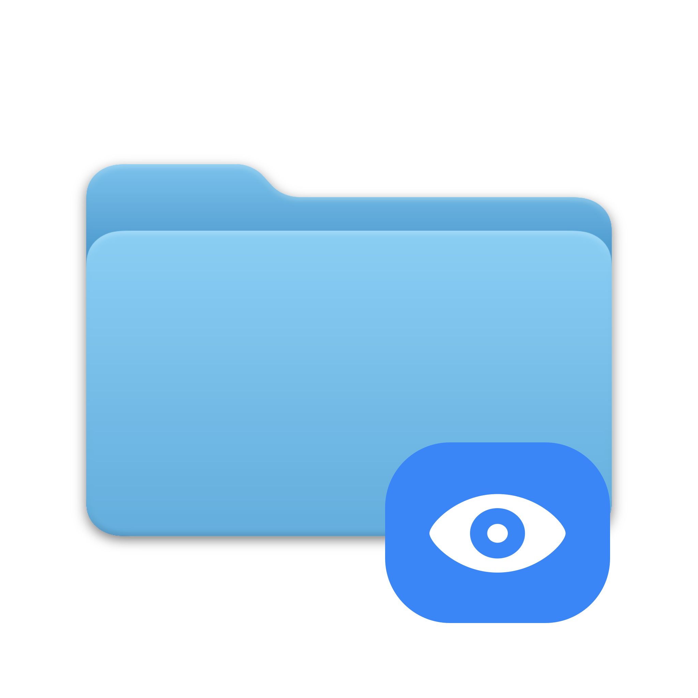
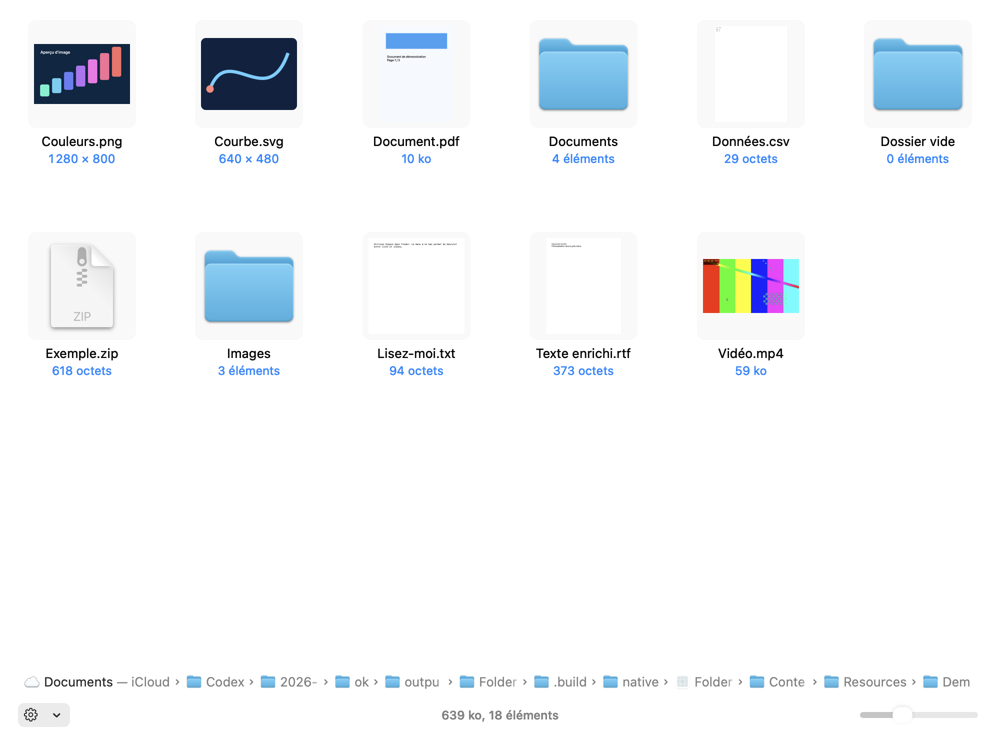

# Folder Preview Droplet

Une réimplémentation pour **Droppy** de l’expérience publique de [Folder Preview](https://anybox.ltd/folder-preview) : sélectionnez un dossier ou une archive dans le Finder, puis **Espace** ou **⌘Y**. L’aperçu reste dans la vraie fenêtre Quick Look de macOS.



## Fonctionnalités

- **Liste arborescente** : dépliage des sous-dossiers sur place, miniatures, tri et colonnes redimensionnables/réordonnables.
- **Grille d’icônes** : miniatures, noms centrés, dimensions/tailles/nombres d’éléments et curseur de taille.
- **Barre inférieure** : chemin, menu de présentation, taille totale et comptage asynchrone.
- Colonnes : nom, modification, création, dernière ouverture, ajout, taille, type, commentaires, tags et dimensions. Les métadonnées absentes restent vides.
- Miniatures système pour images, SVG, PDF, vidéos et autres documents couverts par les fournisseurs installés.
- Archives avec dossiers virtuels : ZIP, TAR, GZ, BZ2, XZ, 7z et RAR selon les codecs système ; JAR et workflows Alfred déclarés comme alias pris en charge.
- Copier un ou plusieurs fichiers, copier leurs chemins, copier une sélection issue d’une archive dans un cache privé borné.
- Options mémorisées : vue, miniatures, fichiers masqués, dossiers en premier, extensions, texte, hauteur des lignes, tailles et dossiers ignorés.

L’étude détaillée, les preuves publiques et les différences non vérifiables sont dans [l’analyse](docs/ANALYSE.md). L’application originale n’a pas été exécutée : l’identité complète de tous ses comportements internes n’est pas certifiée. Les fonctions Pro d’ouverture externe et de glisser-déposer ne font pas partie de la référence standard utilisée ici.



## Installation

Téléchargez les fichiers compilés dans les [Releases](https://github.com/Nicolasdellim/folder-preview-droplet/releases).

1. Importez **FolderPreviewDroplet.droplet** dans Droppy, via les droplets locaux, puis autorisez ce build local lorsque Droppy le demande.
2. Ouvrez les réglages du droplet et cliquez **Installer / ouvrir**. Le composant inclus est copié dans `~/Applications/Folder Preview Droplet.app`.
3. Activez **Folder Preview Droplet** dans **Réglages Système → Général → Ouverture et extensions → Coup d’œil / Quick Look**. Le chemin exact varie selon macOS.
4. Sélectionnez un dossier dans le Finder puis pressez **Espace**. Le menu **⚙︎** en bas change la présentation ; un clic droit sur les en-têtes configure les colonnes.

Le composant hôte sert à l’activation ; l’usage quotidien passe par le Finder et Droppy. Les PDF et images sélectionnés directement conservent leur fournisseur Quick Look système.

**Build personnel** : les binaires sont signés ad hoc, sans certificat Developer ID ni notarisation Apple. Une copie téléchargée peut demander une autorisation macOS. Ne désactivez pas globalement Gatekeeper. La publication au Store officiel Droppy n’est pas effectuée.

## Utilisation

En liste, cliquez sur le chevron d’un dossier pour afficher ses enfants. En grille, double-cliquez sur un dossier pour le parcourir ; le chemin du bas permet de revenir dans la racine sélectionnée. Le menu contextuel contient Copier et Copier le chemin. ⌘C copie les fichiers sélectionnés et ⌥⌘C leurs chemins.

Les dossiers ignorés sont identifiés par leur nom : sélectionnez un dossier puis utilisez **⚙︎ → Dossiers ignorés** ; retirez l’exclusion dans le même menu. Les préférences appartiennent à l’extension Quick Look. Le composant de démonstration et le harness de développement ont leurs préférences séparées.

## Limites et confidentialité

- Tout traitement est local ; le code n’ajoute ni télémétrie, ni réseau, ni intercepteur clavier global. Les fichiers source ne sont jamais modifiés.
- Les liens symboliques ne sont pas parcourus. Les paquets restent des éléments non dépliables. Les fichiers iCloud non téléchargés gardent leur icône.
- Énumération : 50 000 éléments et budget de temps ; totaux : 200 000 éléments, profondeur 64 et budget séparé. Un résultat partiel porte une indication.
- Miniatures d’entrées d’archive : 50 Mo maximum par fichier. Copie depuis une archive : 10 000 éléments, 50 Mo par fichier et 256 Mo par opération. Une archive partielle ne permet pas de copier un dossier prétendument complet.
- Une copie d’archive matérialise les fichiers dans un cache privé. Les entrées anciennes sont purgées lors d’un accès ultérieur au cache, après 24 h ; le collage dépend de leur conservation. Copier le chemin d’une entrée produit un chemin virtuel `archive:/entrée`.
- Les archives chiffrées ou multi-volumes et certains codecs peuvent être refusés. La couverture effectivement testée est précisée dans [le rapport](docs/VALIDATION.md).
- Les commentaires, dates et tags dépendent de ce que macOS fournit. Les dimensions SVG sont extraites des dimensions explicites ou du viewBox quand elles sont lisibles.
- La priorité d’un fournisseur Quick Look est décidée par macOS. Les gestionnaires tiers ne sont pas certifiés par cette livraison.

Désactiver le droplet ne désactive pas l’extension système. Pour désinstaller, désactivez l’extension dans macOS, retirez l’application hôte, puis retirez le droplet de Droppy.

## Build et tests

Xcode 26 / Swift 6.2, macOS 14+ et Python 3. Le droplet déclare Droppy 15.3+ et DroppyKit API 1.9+. Les dépendances sont verrouillées dans `Package.resolved`.

```sh
./Scripts/test.sh
./Scripts/build.sh
./Scripts/package.sh
```

Le build natif produit arm64 et x86_64. Le SDK officiel produit le bundle avec une liaison au framework DroppyKit du processus hôte. Une copie de ce framework n’est pas embarquée dans le droplet.

```sh
".build/native/Folder Preview Droplet.app/Contents/MacOS/FolderPreviewCompanion" --verify "$PWD/.build/verification"
```

Ajoutez `--dark` pour les contrôles de rendu sombre. Les vérifications s’exécutent dans l’application de test, puis la quittent. Les scénarios Quick Look et le harness sont décrits dans le rapport.

## Provenance

Le code de ce dépôt est sous licence MIT. Aucun code, binaire, icône ou document personnel de l’application Anybox n’est livré. L’icône et les documents de démonstration sont propres au projet. Voir [les dépendances](docs/DEPENDENCIES.md) pour libarchive et les fixtures tierces.
